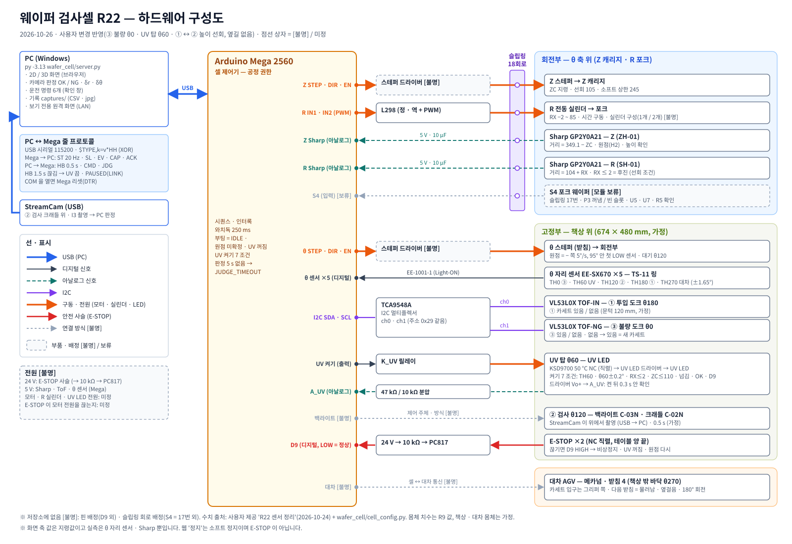

# 웨이퍼 검사셀 R22 공정 모니터 (`wafer_cell/`)

R22 셀의 공정을 브라우저에서 **실시간 애니메이션과 상태 대시보드**로 보여 줍니다.

- **셀 구성**: 장소 4곳(① 투입 θ180 · ② 검사 θ120 · ③ 불량 θ0 · UV 탑 θ60)과 대차 받침(θ270), 3축(θ · Z · R)
  - **사용자 변경(2026-10-24)**: R22 문서는 UV 탑 θ0 · ③ θ60이었는데 둘의 자리를 맞바꿨습니다. RX · 반경은 장소를 따라갑니다(UV 85 · r 269.5, ③ 51 · r 235.5).
    θ 자리 센서 5개는 그대로이고 이름만 바뀝니다: **TH0 = ③ 자리, TH60 = UV 자리**(UV 켜기 조건도 TH60 · θ 60 ± 0.2°).
- **두 가지 데이터 소스**
  - **SIM**: 시뮬레이터(기본값)
  - **LIVE**: 셀 Mega(Arduino Mega 2560)를 시리얼로 연결
  - 두 소스는 **같은 화면**을 씁니다.
- **LIVE 역할 분담**
  - **Mega**: 공정을 돌립니다(시퀀스 · 인터록 · 센서 판정 · UV 램프).
  - **PC**: 화면을 보여 주고, 카메라로 판정하고, 운전 명령 6개를 보냅니다.
- **출처**
  - 사용자 제공 문서 `R22 센서 정리`(2026-10-24, CAD okmech22.py)
  - 사용자가 설명한 공정 흐름(아래 '공정')
  - 문서에 없는 값은 `cell_config.ASSUMED`(가정)로 둡니다.
  - 몸체 치수는 이전 R9 모니터 값을 이어 씁니다.
- **의존성**: 새로 설치할 것은 없습니다.
  - 표준 라이브러리 HTTP 서버를 씁니다.
  - 카메라를 쓸 때만 기존 opencv가, 실제 COM 포트를 쓸 때만 기존 pyserial이 필요합니다.
  - 인터넷(CDN)은 필요 없습니다. 3D 화면의 three.js(r160, MIT)도 `web/`에 같이 들어 있습니다(아래 '3D 보기').
- **함께 볼 문서**
  - 시리얼 규격(펌웨어 작성자용): [PROTOCOL.md](PROTOCOL.md)
  - 하드웨어 구성도: [docs/system_hardware.svg](docs/system_hardware.svg)(PNG: [docs/system_hardware.png](docs/system_hardware.png), 아래 '하드웨어 구성도')
  - 인수인계: [handoff/README.md](handoff/README.md)

## 실행 (작업폴더 = 저장소 루트, Windows PowerShell)

```powershell
py -3.13 wafer_cell/server.py                                   # SIM, 카메라 없음(개념도)
py -3.13 wafer_cell/server.py --cam 1 --speed 5                 # 검사 웹캠 인덱스 1, 5배속
py -3.13 wafer_cell/server.py --source live --serial fake       # LIVE 경로를 가짜 장비로(하드웨어 없이)
py -3.13 wafer_cell/fake_mega.py --tcp 8770                     # 가짜 장비를 따로 띄우고
py -3.13 wafer_cell/server.py --source live --serial tcp:127.0.0.1:8770
py -3.13 wafer_cell/server.py --source live --serial COM5       # 실제 셀 Mega (펌웨어가 PROTOCOL.md 를 따를 때)
py -3.13 wafer_cell/server.py --lan                             # 같은 네트워크에 공개(원격 = 보기 전용)
```

**접속**
- 브라우저 주소는 **`http://127.0.0.1:8765/`**입니다. `localhost`는 ::1로 풀려 느릴 수 있습니다. F11로 전체화면.
- 코드를 갱신(`git pull`)했으면 서버를 재시작하고 브라우저에서 **Ctrl+F5**를 누릅니다.
- **3D 보기**: 헤더 `3D` 버튼(새 창) 또는 `http://127.0.0.1:8765/3d.html`. 보기 전용입니다(아래 '3D 보기').

**사용 순서**: **원점 복귀 → 시작**. 그 뒤로는 대차 카세트부터 자동으로 흘러갑니다.

**버튼**
- 헤더에는 지금 누를 수 있는 버튼만 나오고, 다음에 누를 버튼이 강조됩니다.
- 확인 창: LIVE에서는 6개 명령 모두 확인 창을 거칩니다. SIM에서는 원점 · 시작 · 재개 · 알람 해제만 확인 창을 거칩니다.
- `도구 ▾`
  - 시뮬 전용: 배속, `작업자 자동`, 카세트 웨이퍼 맵, 대차 맵, 고장 주입, E-STOP 시뮬
  - 공통: `다음 웨이퍼 NG`(PC 판정), 테마, 이벤트 로그

**주의: 실제 COM 포트를 열면 Mega가 리셋됩니다(DTR).**
- 서버를 다시 시작하면 장비도 처음 상태(IDLE · 원점 미확정)로 돌아갑니다.
- 그래서 공정 중에는 서버를 끄지 마세요. 브라우저 창은 닫았다 열어도 됩니다(포트는 서버가 잡고 있음).

## 공정 (사용자 설명 + R22 문서)

1. **대차 → ①** (C1–C5): 대차 받침의 카세트를 클램프 윗판째로 들고 ① 도크에 놓습니다.
   - 카세트를 든 채 θ270 → 180 짧은 길로 돕니다(슬립링, Z241).
2. **① 슬롯 1 → 5 (아래부터)** 웨이퍼마다 다음을 합니다.
   - **꺼내기 P1–P3**: P3에서 들어 올린 뒤 **S4 ON = 꺼냄, OFF = 빈 슬롯**입니다. 빈 슬롯이면 E1을 거쳐 다음 슬롯으로 가고, 알람은 내지 않습니다.
   - **② 검사 I1–I4**: 웨이퍼를 빼면 **Z105로 내리지 않고 그 높이 그대로 ② 120으로 바로 돕니다**(사용자 변경 '높이 선회'). 도는 길에 걸리는 벽은 ② 크래들(z 244~252)뿐이라, 슬롯 4만 크래들 밑으로 15.5 mm 내린 뒤 돕니다(`transfer_z`). ②에서 놓는 높이 192로 맞춰 크래들에 놓기 → StreamCam 촬영 · **PC 판정(OK/NG + δr, δθ)** → **보정해서 다시 집기**(RX 51 + δr · θ 120 + δθ)
   - **불량 N1–N2**: ③ 위 슬롯부터 넣고 다음 웨이퍼로 갑니다.
   - **정상 U1–U7 → R1–R5**
     - UV 탑 밑으로 넣어 받침에 넘깁니다(ZC 121.5 → 113.5).
     - 포크를 빼고 ZC 105로 내린 뒤 **UV 10 s**(가정)를 쬡니다.
     - 다시 집습니다.
     - UV 60 → ② 앞 120(Z105)에서 그 슬롯 높이로 올린 뒤 **그대로 θ180으로 돌아** **① 원래 슬롯**에 넣습니다(한 방향, 우회 없음). UV 탑 밑에서는 121.5 위로 못 가고 ① 앞에서는 아래 슬롯 웨이퍼와 겹치므로 높이는 ② 앞에서 맞춥니다.
3. **① → 대차** (L1–L7): 5장이 끝나면 ① 카세트를 들어 **원래 받침**에 놓습니다.
   - 대차가 다음 받침을 로봇 앞으로 옮깁니다(물러남 · 옆걸음 · 180° 회전).
   - 받침을 다 처리하면 대차가 출발하고 새 대차를 부릅니다.
4. **③ 가득 / 없음 → `WAIT_NG`**(교체 요청)
   - TOF-NG가 '없음 → 있음'으로 바뀌면 새 빈 카세트로 보고 포인터를 0으로 되돌립니다.

단계 표(39개)와 각 단계의 동작 순서는 [PROTOCOL.md §5](PROTOCOL.md)에 있습니다. 화면 타임라인과 같은 키를 씁니다.

**사이클(가정 속도, 등속이라 하한값, 시뮬로 잼)**
- 정상 웨이퍼: 슬롯 1 → 5에서 **89 → 106 s**(UV 10 s 포함). 높이 선회로 Z105까지 내렸다 올리던 시간(Z 10 mm/s)이 빠져 옆길 방식(94.5 → 123 s)보다 6~17 s 짧음
- 불량 웨이퍼: **약 57–65 s**(전 71–74 s)
- 대차 1대(카세트 4 × 5장, 전부 정상): **약 39분**(불량 10 %면 약 37분)
- 원점 복귀: 전원 투입 자세(θ150 · Z140 · R30)에서 약 11 s

### 내가 정한 해석 — 확인이 필요함

1. **웨이퍼를 든 ① ↔ ② 는 '높이 선회'입니다(사용자 변경 2026-10-26 — R22 문서는 Z105로 내려 돌고 옆길 220).**
   - ① 도크가 22 mm 바깥이라, 후진한 **빈** 포크(끝 R ≤ 205)는 ① 웨이퍼(207.5~)에 닿지 않고 ① 앞에서 오르내립니다.
   - 하지만 **웨이퍼를 든** 후진 포크는 아래 슬롯 웨이퍼와 반경 27~29 mm 겹칩니다(R9 몸체 치수 기준). 그래서 ① 앞에서는 다른 슬롯 높이를 지나는 Z 이동을 하지 않고, 들기 높이 그대로(슬롯 4만 15.5 mm 내려) 180 ↔ 120을 돕니다. 높이 맞춤은 ②에서(꺼낼 때 192, 되돌릴 때 슬롯 높이) 합니다.
   - 문서의 'ZC 205 (슬롯 5 옆길)'를 역산해 들기 높이를 Sn − 57로 잡았습니다(`SIDE_OFS`, 가정).
   - 높이 선회 높이 `transfer_z`(슬롯 1~5): 133 · 151 · 169 · 171.5 · 205. ② 크래들 띠 z 244~252(`CRADLE_BAND_Z`)와 5 mm(`HIGH_SWING_MARGIN`) 이상 떨어지게 정합니다(가정값).
2. **카세트 운반 = 180 ↔ 270 짧은 길**(슬립링 18회로, Z241).
   - 긴 길(120 · 60 · 0을 지나는 길)은 ③ 카세트와 부딪힙니다(계산).
3. **원점 순서는 R 후진 → Z(Sharp) → θ 찾기 → 대기 θ120**입니다.
   - 문서는 Z를 먼저 적었지만, 포크가 카세트 안에 있으면 긁기 때문에 R을 먼저 뺍니다(R9에서 정한 순서).
4. **대차는 카세트 1~4개**를 싣고 옵니다. 기본은 4개(R9 영상)이고, 시뮬 `대차 맵`에서 1개로 바꾸면 '한 번 오고 떠나는' 흐름이 됩니다.
5. **판정 알고리즘은 [미구현]**입니다. 지금은 기본 OK · δ = 0이고, `다음 웨이퍼 NG`(SIM · LIVE)와 NG 비율(SIM)로 정합니다.
6. **대기 θ120 · UV 받침 z183 · ToF 문턱 120 mm · Sharp 허용 ±3 mm · 판정 응답 5 s · UV 10 s**는 가정값입니다.

## 센서 (R22 문서 §0) — 화면 어디에 보이나

| 센서 | 개수 | 쓰는 곳(시퀀스) | 화면 |
|---|---|---|---|
| θ 자리 포토 EE-SX670 + EE-1001-1 | 5 | 자리마다 확인(expect_th), 원점 찾기(H3), UV 조건 | 평면도 허브 둘레 5점(LOW = 초록, 2개 이상 = 빨간 링), 상세 칩 TH0–TH270 |
| Z Sharp GP2Y0A21 | 1 | 원점(H2), 높이 확인(vz). 거리 = 349.1 − ZC | 상세 축 Z의 점선 눈금, 입면도 점선 캐리지 |
| R Sharp GP2Y0A21 | 1 | 후진 확인(ret ≤ 2), 전진 확인(vr). 거리 = 104 + RX | 상세 축 R의 점선 눈금, 선회 허용/금지 |
| ToF VL53L0X (+TCA9548A) | 2 | TOF-IN: ① 카세트 있음/없음(C4 · C5 · P1 · R3 · L1), TOF-NG: ③ 있음 · 교체 감지 | 칩 TOF-IN/NG, 하단 띠 '없음' |
| S4 포크 웨이퍼 [모듈 보류] | 1 | P3(꺼냄/빈 슬롯), I2 · N2 · U5 · R5(놓고 뺀 뒤 OFF), I4 · U7(다시 집은 뒤 ON) | 포크 위 점, 칩 S4 |
| 카메라 StreamCam | 1 | I3 촬영 → PC 판정 | 하단 카메라 칸(개념도 / LIVE) |
| UV 감시 KSD9700 · A_UV · D9 | — | U6: 7가지 조건, A_UV 0.3 s, 조사 중 꺼짐 | UV 탑 빛, 하단 UV 칸(남은 초), 칩 UV · A-UV · D9 |

## 하드웨어 구성도



- 원본은 `docs/system_hardware.svg`(손으로 고칠 수 있는 SVG)입니다. `docs/system_hardware.png`는 보고서 · PPT 용 2배 렌더(3200 × 2200)입니다. SVG를 고치면 PNG를 다시 만들어야 합니다.
- 근거: 이 README의 센서 표 · UV · E-STOP, [PROTOCOL.md](PROTOCOL.md)(링크 규칙), [센서_구매목록.md](센서_구매목록.md) R22 주문표, `cell_config.py`(자리 · 슬립링 18회로 · 책상 가정).
- 점선 상자 = **[불명]**(저장소에 근거 없음): 스테퍼 드라이버 모델, D9 외 Mega 핀 배정, 슬립링 회로 배정(S4 = 17번만 확정), R 전동 실린더 구성, 백라이트 제어 주체, 대차(AGV) 통신, 전원 구성, S4 모듈(보류).
  핀은 일부러 적지 않았습니다(R9 시절 핀 표는 옛 설계). 정해지면 SVG 의 해당 상자를 실선으로 바꾸고 값을 적습니다.

## 화면 구성
기본 화면은 발표용입니다(설명은 발표자가 합니다).
- **헤더**
  - 제목, `시뮬레이션`/`실장비` 배지
  - LIVE면 연결 배지: 장비 연결 · 연결 끊김 · 응답 대기 · 데이터 멈춤 · 프로토콜 불일치 · pyserial 없음
  - 상태 단어, 버튼. 소프트 정지는 항상 같은 자리에 있습니다.
- **흐름 띠**: 대차 › 투입 › 검사 › 불량 › UV › 원위치
  - 그 아래 큰 제목 한 줄. 예: `웨이퍼 3 — UV 조사 10 s (남은 4 s)`
  - 그 아래 진행 막대(단계 39칸)
- **평면도**: 보기를 −90° 돌려 대차를 화면 오른쪽에 둡니다(넓은 패널에 대차 받침 4칸이 들어가게).
  - 화면 위 = ③, 왼쪽 위 = UV, 왼쪽 아래 = ②, 아래 = ①
  - 높이 선회 ② ↔ ①(주황 점선), 카세트 운반 경로(파란 점선), θ 센서 5점을 그립니다.
  - **책상**: 장소 4곳과 로봇 받침을 모두 감싸는 사각형(실선 테두리 + 옅은 면, 왼쪽 아래 `책상` 글자)입니다.
    크기 674 × 480 mm(셀 x −350 ~ +324, y −140 ~ +340)는 **가정**입니다 — 장소 도형 꼭짓점(UV 탑 몸통 · 빛 포함) + 여백 20 mm로 계산했습니다.
  - **대차 카세트 입구 = 그리퍼 쪽**: 앞 받침(앞 왼 · 앞 오른) 카세트는 입구가 셀 쪽, 뒤 받침은 바깥쪽입니다. 대차가 180° 돌아 뒤 받침을 내어 주면 그 입구도 셀 쪽이 되므로, 어느 받침이든 포크 앞에 올 때 입구가 로봇을 봅니다(`CART_SEAT_FACE`). 들어 올린 카세트는 포크와 같이 돌아 ①에 놓을 때도 입구가 로봇 쪽입니다. 실제 대차에 어떻게 싣는지는 [불명]입니다.
  - **대차**: 책상 밖 바닥(대차 쪽 책상 끝 y −140)에서 움직입니다. 도킹하면 앞면(y −189.5)이 책상 끝에서 49.5 mm 떨어지고, 포크(RX 85)만 책상 끝을 넘어 받침(r 269.5)에 닿습니다.
- **입면도**: 포크 방향 단면입니다. 서 있는 자리의 ① 카세트(+22 mm) · ③ · ② 크래들 · UV 탑(받침 · 램프 빛) · 대차 받침을 그리고, 포크 위 웨이퍼/카세트를 함께 보여 줍니다.
- **하단**
  - 검사 카메라, 검사 누적 수
  - **① 슬롯 5칸**: 점선 = 있다고 봄(슬롯마다 센서가 없음) · 주황 점선 = 꺼냄 · 초록 = 원위치 · 빨강 = 불량으로 · 빨강 점선 = 빈 슬롯
  - **③ 5칸**(위부터 참)
  - **UV**(받침 웨이퍼 · 남은 초)
  - **대차 받침 4칸**(보라 = 처리 전 · 주황 = 셀에서 처리 중 · 초록 = 끝)
- **알람 바**: 다음 경우에만 나옵니다.
  - 알람
  - ③ 교체 요청
  - PC 연결 끊김 일시정지
  - LIVE 연결 이상
- **상세** (D 키 / `상세` / `?detail=1|0`. 기본값은 SIM OFF · LIVE ON)
  - 카운트, 마지막 판정(δr · δθ), Sharp 환산값
  - UV 조건 미충족 항목
  - LIVE 연결 정보(포트 · 부팅 id · 깨진 줄 · 빠진 ST · 재시작)
  - 축(지령값 + Sharp), 센서 칩 12개, 선회 허용/금지(사유는 툴팁), `가정 37`(가정값 목록 툴팁)
- **테마 점검(다크 · 라이트)**: 보이는 글자마다 글자색과 실제 화면 배경(스크린샷 화소)의 WCAG 대비를 쟀습니다(작은 글자 4.5, 큰 글자 3.0).
  - 범위: 두 테마 × 1920/1536 × 상세 OFF/ON × 8상태(IDLE · C4 · I3 · U6 · R3 · WAIT_NG · ALARM · ESTOP) = 64화면 + LIVE 끊김 8화면 + 3D 4화면
  - 고친 것: 라이트 주황(`--amber` 4.1 → 5.7), 라이트 웨이퍼 보라(4.3 → 5.0), 흐린 회색 `--ink3`(다크 4.1 → 4.9, 라이트 3.7 → 4.9),
    알람/비상정지 상태 글자(깜박일 때 1.9 → 글자는 그대로 두고 바탕만 깜박), 켜진 S4 글자(라이트에서 흰 글자)
  - 남긴 것(의도): 비활성 버튼, 카세트가 없을 때 흐린 슬롯 번호(칸 머리에 `없음`이 따로 나옴)

### 3D 보기 (`/3d.html`, 보기 전용)
- 같은 서버의 `/events`(SSE)와 `/api/meta`를 받아 **2D와 같은 스냅샷**으로 움직입니다. 명령은 보내지 않습니다(조작 토큰 없음).
- 그리는 것: 바닥 · 책상(상판 + 다리) · 로봇(θ 회전부 → Z 캐리지 → R 포크, 포크 위 웨이퍼/카세트, S4) · θ 자리 센서 5점 · ① ③ 카세트(슬롯 코드별 웨이퍼 색) · ② 크래들 · 백라이트 · 카메라 · UV 탑(램프 켜지면 보라 빛) · 대차(바닥 섀시 + 기둥 4 + 상판, 받침 4, 바퀴, 받침 카세트 + 클램프 윗판 — 입구는 위 '대차 카세트 입구' 규칙).
- 시점 버튼: `비스듬히` · `위`(2D 평면도와 같은 방향: 위 = ③, 오른쪽 = 대차) · `대차 쪽` · `UV 쪽`(UV 탑 자리 바깥에서) · `포크 따라가기`. 끌기 = 돌리기, 휠 = 확대, 오른쪽 끌기 = 옮기기. `?view=top`, `?theme=light`도 됩니다.
- 테마는 2D와 같은 저장값(`wc-theme`)을 씁니다.
- **한계**: 모양은 상자 · 원기둥 근사입니다(CAD 아님). 치수는 2D와 같은 R9/R22 값이고 책상 · 대차 몸체는 가정입니다. 브라우저에 WebGL이 꺼져 있으면 3D가 안 뜹니다(Chrome/Edge `chrome://gpu`에서 WebGL 확인).
- three.js: `web/three.module.min.js`, `web/OrbitControls.js`(r160 = 0.160.0, npm 패키지 `three`, MIT, 라이선스 `web/three.LICENSE`). 오프라인으로 동작합니다.

## 정직성 표기 (화면이 거짓 확신을 주지 않게)
| 표시 | 의미 |
|---|---|
| `시뮬레이션` / `실장비` 배지 | 데이터 소스입니다. 항상 표시합니다. |
| 축 = 지령값 | θ와 Z는 스텝 수, R은 실린더 시간 모형입니다. 실제 위치는 θ 자리 센서 · Sharp로만 확인합니다. Sharp 값은 상세에 따로 보입니다. |
| ① 슬롯 점선 | 슬롯마다 센서가 없습니다. 카세트가 오면 5장 있다고 '봅니다'. P3의 S4로 하나씩 확정됩니다. |
| 사이클 (가정 속도) | 등속 · 가정 속도로 낸 하한값입니다. |
| 대차 움직임 | 시뮬은 시간 모형입니다. LIVE는 Mega가 보낸 받침 정렬(cal)로만 그립니다. 대차 통신은 [불명]입니다. |
| `데이터 정지` 오버레이 | SSE가 1.5 s 끊기거나 tick(LIVE = 받은 ST 수)이 멈추면 뜹니다. 이때 조작 버튼은 비활성입니다. |

## LIVE (셀 Mega) 연결 — 자세한 규격은 [PROTOCOL.md](PROTOCOL.md)

- **줄 형식** `$TYPE,k=v,...*HH`(XOR 체크섬, ASCII)
  - Mega → PC: `HEL`(부팅) · `ST`(20 Hz 상태) · `SL`(슬롯 · 카운터) · `EV`(이벤트 · 알람) · `CAP`(촬영 요청) · `ACK`(명령 응답)
  - PC → Mega: `HB`(0.5 s) · `CMD`(6개 + hello) · `JDG`(판정)
- **PC 쪽 규칙**
  - 연결이 OK가 아니면 명령은 503, ACK가 1 s 안에 안 오면 504입니다. 장비가 거부하면 화면에 '장비 거부: 이유'를 띄웁니다.
  - 다시 연결해도 명령을 다시 보내지 않습니다.
  - 시뮬 전용 명령(고장 주입 · 배속 · 맵 · 웨이퍼 치움)은 LIVE에서 400입니다.
- **Mega 쪽 규칙(가짜 장비가 그대로 따름)**
  - 하트비트가 1.5 s 끊기면 UV를 **즉시** 끄고, 지금 하던 축 동작만 끝낸 뒤 `PAUSED(LINK)`가 됩니다. 재개는 사람이 합니다.
  - 최근 명령 id 8개는 다시 실행하지 않습니다.
  - CAP 뒤 5 s 안에 판정이 없으면 `JUDGE_TIMEOUT`입니다.
- **AI(클로드)가 쓰는 LIVE는 가짜 장비(`--serial fake`, `fake_mega.py`)뿐입니다.** 실제 장비에 명령을 보내는 것은 사람이 버튼과 확인 창으로만 합니다(CLAUDE.md §7).

## 동기화 — LIVE 화면이 장비와 같은 것 · 다른 것
- **시험으로 보증하는 것**(`tests/test_wafer_sync.py`): 가짜 장비가 `ST`를 보낼 때마다 그 순간 장비 스냅샷을 기록하고, PC가 받은 스냅샷과 **매 프레임** 비교합니다.
  비교 항목: 상태 · 일시정지 이유 · 단계(키 · 동작 · 제목) · 슬롯 · ③ 포인터 · 웨이퍼 번호 · 원점 · 자세(θ ±0.006°, Z/R ±0.06 mm = 프로토콜 반올림) · Sharp · 센서 12개 · ①③ 슬롯 코드 · 포크/크래들/UV 받침 · UV 램프와 남은 초 · 대차(상태 · 받침 · 정렬 · 문구, 도킹 중 자세) · 판정 · 카운터 · 알람 · 선회 허용.
  시나리오: 원점 → 시작 → 정상 · 불량 · 빈 슬롯 → UV 중 하트비트 끊김 → 재개 → 판정 시간 초과 → 해제 → 대차 이동/도킹. 결과는 **2,413 프레임, 불일치 0**이고, 일부러 슬롯 코드를 틀리게 바꾸면 시험이 실패하는 것도 확인했습니다.
- **같은 것**: 자세는 Mega **지령값**, 센서는 Mega가 읽은 값 그대로입니다. 가짜 장비는 `ST`와 `SL`을 같은 순간의 스냅샷 하나에서 만들어 둘이 어긋나지 않습니다.
- **다른 것(장비가 모르는 것은 그리지 않음)**
  - ① 슬롯마다 웨이퍼 센서가 없습니다 → 점선 '있다고 봄', P3의 S4로 확정.
  - 대차가 움직이는 동안 위치 데이터가 없습니다 → LIVE에서는 도킹 자리에 **점선 반투명 대차**(3D도 반투명)와 동작 문구만 보입니다.
  - 실제 위치는 Sharp · θ 센서뿐입니다 → Sharp와 지령값 차이가 `SHARP_TOL`(±3 mm)을 넘고 축이 멈춰 있으면 알람 바 자리에 **주황 경고**(`Z 실측 차 6.0 mm`)를 띄웁니다.
- **지연 예산(계산값)**: 화면은 서버가 `ST`를 받은 시각(`t_src`)보다 **160 ms**(SIM은 publish 시각보다 120 ms) 늦게 그립니다 — SSE 20 Hz(50 ms 간격)와 흔들림을 흡수하는 버퍼입니다.
  여기에 Mega의 `ST` 주기(0~50 ms)와 시리얼 전송(115200 bps, 190 B ≈ 17 ms)을 더하면 LIVE **장비 → 화면 ≈ 0.18~0.23 s**입니다.
  같은 `ST`가 반복된 스냅샷은 버퍼에 넣지 않으므로 20 Hz 자세가 '멈춤–점프' 계단 없이 이어집니다.
  연결 배지의 `nnn ms`는 마지막 수신 뒤 지난 시간입니다. Mega 시계가 PC와 맞춰져 있지 않아 **장비 → 화면 실제 지연은 잴 수 없습니다**.
- **시험이 보증하지 않는 것**: 실제 Mega 펌웨어가 같은 값을 보내는지. 펌웨어가 생기면 같은 시험을 실제 시리얼 기록으로 다시 돌려야 합니다.

## 가정값 (`cell_config.py`에서 수정, `ASSUMED` 37개 — 화면 `가정 37` 툴팁)
| 이름 | 값 | 근거/상태 |
|---|---|---|
| SIDE_OFS | −57 (Z = Sn − 57) | 들기 높이. 문서 '205 (슬롯 5 옆길)'에서 역산했습니다. 운반 웨이퍼 윗면 → 윗 슬롯 이빨 3.5 mm |
| CRADLE_BAND_Z · HIGH_SWING_MARGIN | z 244 ~ 252 · 5 mm | 높이 선회 때 운반 웨이퍼가 피할 ② 크래들 팔 · 패드 높이(화면 · 3D 모양)와 여유. 실물 크래들 치수로 고칩니다. |
| THETA_STANDBY | 120° | R9 값입니다. R22 문서에는 없습니다. |
| UV_SEAT_Z / UV_S | 183 / 10 s | 받침 패드 높이는 113.5와 121.5 사이에서 골랐습니다. 조사 시간은 사용자가 아직 모릅니다. |
| SHARP_TOL / SHARP_NOISE | ±3 / ±0.5 mm | 데이터시트에 반복 정밀도가 없습니다. 10–20번 평균 기준[실측] |
| TOF_PRESENT_MM / TOF_CASS_D | 120 / 40 mm | ① 도크를 22 mm 옮겼으므로 TOF-IN 문턱을 다시 티칭해야 합니다. |
| JUDGE_TIMEOUT_S | 5 s | PC 판정 응답 제한 |
| S4_LOCAL_X / S4_RANGE | 68 / 0–10 mm | S4 모듈 · 자리 [보류]. 화면은 R9 갈래 자리 |
| CASS_LIFT_Z / CASS_SEAT_LIFT_Z | 235 / 223 | 카세트가 도크/받침 ↔ 포크로 넘어가는 높이(R9) |
| CART_DEFAULT_MAP | 4개 | 대차 한 대의 카세트 수 |
| DESK_X0 · X1 · Y0 · Y1 | −350 · +324 · −140 · +340 mm | 책상 윗면(셀 좌표). 장소 · 로봇 받침을 감싸는 최소 사각형 + 여백 20 mm. 실측하면 이 4개만 고칩니다. |
| DESK_TOP_Z · DESK_H | −60 · 720 mm | 책상 윗면 높이(θ 센서 링 z −37.5 아래), 다리 길이(3D 바닥 = −780) |
| CART_BODY | x −90 · y −80 · 380 × 420 mm | 대차 몸체(받침 FL 기준). 화면 모양만 정합니다. |
| WAFER_T / LEDGE_T | 2 / 4 mm | 3D 프린트 모형 |
| THETA/Z/R_SPEED · CAPTURE_S | 60°/s · 10 · 20 mm/s · 0.5 s | 속도 |
| NG_RATE · OPERATOR_S · CART_*_S | 0.10 · 8 s · 8/2/2/3/4/5 s | 시뮬 전용 |

## 상태 스냅샷 (SSE `/events`, `/api/state`) — SIM과 LIVE가 같은 모양
`tick, t, source, state, pause_reason, speed, pose{theta,zc,rx}, meas{zd,rd,zc_s,rx_s,tof_in,tof_ng}, target, homed, homed_axes,
step{key,group,title,detail,stage,action,actions}, stage, phase, slot, ng_slot, wafer_no, headline, subline,
sensors{TH0,TH60,TH120,TH180,TH270,S4,TOF_IN,TOF_NG,A_UV,D9,ESTOP}, th_low, expect,
docks{input{present,seat,slots[{n,code}]}, ng{present,count,slots}}, fork{wafer,judgment,cassette}, inspect{wafer,judgment}, uvh{wafer},
uv{lamp,a_uv,total_s,left_s,handed,missing}, cart{state,seats{FL..RR: F|W|D|null},aligned,caption,rot,lat,dist,departed},
judgment, ng_next, ng_rate, alarm{code,d,msg,step,slot,fatal,t}, interlock{rotate_ok,why,mode}, counts, faults, operator, link, log_seq`
(서버가 `boot_id, cam, wall, captures`를 더합니다.)

**상태**: `IDLE, HOMING, READY, RUNNING, WAIT_CART, WAIT_NG, PAUSED, ALARM, ESTOP`

**명령**: `POST /api/cmd {cmd, args, expect_state}`
- 장비로 가는 것: `home, start, pause, resume, stop, reset`
- PC 판정: `next_ng`(SIM/LIVE), `ng_rate`(SIM)
- SIM 전용: `speed, fault, estop, operator{task: ng}, auto_operator, cart_map, input_map, remove_wafer{loc}, debug_hold`
- 고장 주입 15개
  - θ 센서: `th_double · th_dead · belt_skip`
  - Sharp: `z_sharp_drift · r_sharp_fail`
  - S4: `s4_false_none · s4_false_present`
  - ToF: `tof_in_none`
  - UV: `uv_led_fail · uv_overtemp`
  - 판정: `corr_out · judge_drop · camera_fail`
  - 기타: `cart_delay · sim_exception`

**보호**: 다음을 모두 만족해야 명령을 받습니다.
- loopback 클라이언트
- JSON 본문
- Host/Origin이 127.0.0.1 또는 localhost
- 기동 토큰(`X-Wafer-Token`)
- `expect_state` 일치(아니면 409)

## 기록
`wafer_cell/captures/`에 저장합니다(git 제외).
- I3 캡처 jpg(실카메라일 때)
- 웨이퍼별 CSV `wafer_log_YYYYMMDD.csv`: boot_id, source, wafer_no, input_slot, judgment, dest(K/N), dest_slot, dr, dth, uv_s, 시각, cycle_s
  - LIVE는 EV `WDONE` + `CYCLE`로 만들고, 모르는 칸은 비웁니다.

## 현장 확인 절차 [불명] — 하드웨어 의존이라 코드로 단정하지 않음
1. **Sharp 2개**
   - ZC 105 · 121.5 · 205 · 245와 RX 0 · 51 · 73 · 85에서 각각 20번씩 재서 평균과 편차를 기록합니다.
   - 성공 기준: 환산식(349.1 − ZC, 104 + RX)과 평균 차이 ≤ 2 mm, 편차 ≤ ±1 mm.
   - 기준을 넘으면 `Z_SHARP_K` · `R_SHARP_K` · `SHARP_TOL`을 고칩니다.
   - RX −2(후진 끝)는 102 mm로 10 cm 하한에 가깝습니다. 값이 거꾸로 읽히지 않는지 꼭 봅니다.
2. **θ 자리 센서 5개**
   - θ를 0.1°씩 돌리며 LOW 구간을 잽니다. 성공 기준: 구간 ±1.65° ± 0.3°, 동시에 2개 LOW 없음.
   - 원점 찾기를 θ 여러 곳(자리 사이 포함)에서 10번 반복해 같은 자리를 찾는지 봅니다.
3. **높이 선회 틈(R22 도면 필요)**: 웨이퍼 없이 저속으로 슬롯마다 `transfer_z` 높이에서 ① 180 ↔ ② 120을 돌려 틈을 잽니다.
   계산 틈(R9 몸체 · 화면 모양, 가정): ② 크래들 띠와 슬롯 1~5 = 팔 밑 43.5 · 25.5 · 7.5 · **5.0** · 패드 위 18.5 mm, ② 백라이트 · ① 카세트 앞과는 반경 **1.5 / 0.5 mm**(RX 2) — RX −2(지령 후진)면 5.5 / 4.5 mm.
   백라이트 · ① 앞 틈은 예전에도 같았지만(I2 상승 · 옆길) 이제 돌면서 지나므로 R 후진 확인이 중요합니다. 성공 기준: 크래들 띠 3 mm 이상, 반경 1 mm 이상(RX −2 기준 4 mm 이상).
   처음에는 웨이퍼 없이 저속으로, 하드웨어 E-STOP을 손에 쥐고 합니다.
4. **UV**
   - A_UV 분압(47k/10k) 창 문턱을 정합니다. 켠 뒤 0.3 s 안에 들어오는지 봅니다.
   - KSD9700을 가열해 끊기면 `UV_LOST`가 나는지 봅니다.
   - D9 사슬을 끊으면 비상정지가 되고 램프가 꺼지는지 봅니다.
5. **TOF-IN 문턱 다시 티칭**(도크 +22): 카세트 있음/없음 거리를 각각 20번씩 재서 가운데로 `TOF_PRESENT_MM`을 정합니다.
6. **포트 열기 리셋**: 서버를 재시작하면 Mega가 IDLE로 돌아오는지 봅니다. 공정 중 재시작은 금지입니다.
7. **직렬 대역**: `ST` 20 Hz(줄당 약 150–190 B)가 스텝 펄스를 방해하지 않는지 봅니다. 방해하면 10 Hz로 낮춥니다(PROTOCOL.md §7).
8. **책상 · 대차 실측**: 책상 윗면 네 끝(셀 중심 기준)과 높이, 대차 몸체 크기를 재서 `DESK_*` · `CART_BODY`를 고칩니다. 대차가 도킹했을 때 앞면과 책상 끝 사이가 49.5 mm(가정)보다 좁으면 부딪히는지 따로 봅니다.
9. **③ · UV 자리 교체 뒤 확인(사용자 변경)**
   - **불량 경로가 UV 탑 앞을 지남**: ② 120 → ③ 0을 Z105 · RX ≤ 2로 웨이퍼를 든 채 돌면 θ60 UV 탑 앞을 지납니다.
     계산 틈은 운반 웨이퍼 바깥 r 236.5 ↔ UV 받침 패드 r 255.6 = **19.1 mm**입니다(받침 모양은 가정). 웨이퍼 없이 저속으로 돌려 실제 틈을 잽니다. 성공 기준: 10 mm 이상.
   - **UV 빛이 ② 쪽으로 새는지**: UV와 ② 사이가 120°에서 60°로 줄었습니다. 램프를 켠 채 ② StreamCam 영상(백라이트 꺼짐)에 보라 빛이 비치는지 봅니다. 비치면 가림판을 답니다.
   - **배선 · 센서가 장소를 따라감**: UV 램프 · KSD9700 · A_UV 선은 θ60으로, TOF-NG는 θ0으로 갑니다. θ 자리 센서 5개는 그대로이고 펌웨어에서 TH60을 UV 자리 센서로 씁니다.
   - **전원 켤 때 자세**: ③(θ0) ±25° 안에서 Z가 105보다 높으면 원점 Z 하강이 ③ 웨이퍼 반경을 지나 시뮬은 충돌로 멈춥니다(전에는 θ60 둘레). 그 자리에서는 손으로 Z를 내리거나 θ를 비킨 뒤 원점 복귀합니다.
10. **3D 화면(사용자 PC)**: Chrome/Edge에서 `/3d.html`이 뜨는지, `chrome://gpu`의 WebGL이 `Hardware accelerated`인지 봅니다. 느리면 창을 줄이거나 2D만 씁니다.
11. **웹캠 · 이중 실행 · 모형 웨이퍼**(R9와 같음)
   - USB를 뽑으면 1 s 안에 '영상 정지'가 떠야 합니다.
   - 서버를 하나 더 띄우면 `cannot start server`로 끝나야 합니다.
   - 모형 웨이퍼는 밝은색 필라멘트를 씁니다(S4 · ToF 반사).

## E-STOP · 안전 (R9에서 정한 것 유지)
- E-STOP 사슬은 **D9(PC817, LOW = 살아 있음)**이고, 웹 '정지'는 소프트 정지입니다.
- 펌웨어에 넣을 것
  - **와치독**: `wdt_enable(WDTO_250MS)`. 멈추면 리셋되어 모든 핀이 입력이 됩니다.
  - **모터 드라이버 입력에 풀다운**
  - **I2C 멈춤 방지**: `Wire.setWireTimeout(3000, true)`. TCA9548A와 VL53L0X 때문입니다.
- 첫 자율 시험은 **웨이퍼 없이 저속으로**, 하드웨어 E-STOP을 손에 쥔 채 합니다. 한 단계씩(시뮬 `debug_hold`와 같은 방식으로) 멈추며 자세를 확인합니다.

## 미결정 · 다음 단계
- **펌웨어**: [PROTOCOL.md](PROTOCOL.md)를 따르는 셀 Mega 펌웨어(시퀀스 = `sequence.py`, 인터록 = `can_rotate` · `uv_interlock`). 다음 단계 범위입니다.
- **공정 중 정지 뒤 재시작**: 셀 안에 웨이퍼가 남은 채 다시 시작하는 규칙을 정해야 합니다. 시뮬은 `cell_not_clear`로 시작을 거부합니다. 실장비 명령 6개에는 '치웠음'을 알리는 명령이 없습니다.
- **판정 알고리즘**: 불량 판정과 δr · δθ를 구하는 방법이 아직 없습니다(지금은 OK · 0).
- **대차(AGV) 통신**: 호출 · 받침 정렬 · 출발을 어떻게 주고받을지 정해야 합니다. 시뮬은 시간 모형입니다.
- **S4 모듈 · 자리**: 문서 [보류]. 슬립링 17번에 자리만 잡혀 있습니다.
- 이전 R9 화면 · 하드웨어 노트(S3 · 하단 TOF 개수 세기 · OK 카세트)는 git 기록과 [handoff/plan_history.md](handoff/plan_history.md)에 있습니다.
